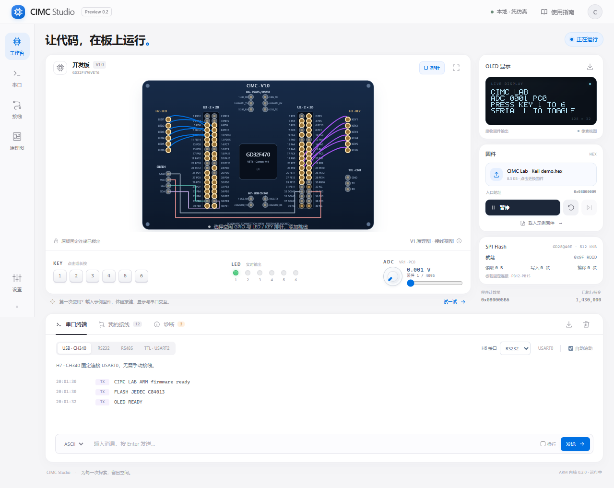

# CIMC Studio

面向 CIMC 工业嵌入式训练的本地固件仿真工作台。支持 **GD32F470 V1.0 与 CIMC V2.0**；Windows 安装版、Ubuntu/Debian 安装版与 HTML 网页共用界面和本地执行内核。

当前发行版本为 **[0.5.1，开发预览](https://github.com/Epiphany-Lucky/cimc-simulator/releases/tag/v0.5.1)**。修复 HAL 启动代码通过外设位带地址访问寄存器时中止的问题，保留 V1/V2 板卡、真实固件执行和应用内更新功能。详情见 [0.5.1 公告](docs/releases/v0.5.1.md) 与 [验收记录](docs/validation-v0.5.1.md)。



## 使用 Windows 版

1. 从 [公开 Releases](https://github.com/Epiphany-Lucky/cimc-simulator/releases) 下载所需版本安装器；0.5.1 的文件名为 `CIMC-Studio-0.5.1-Setup-x64.exe`，运行安装向导（当前用户安装）。实际可下载版本以发行页为准。
2. 从开始菜单或可选桌面快捷方式启动 CIMC Studio；关闭窗口时停止自己启动的仿真服务。仍可使用完整解压的 Windows 便携 ZIP。
3. 先载入“示例固件”验证环境，再导入自己的 HEX 或 BIN；Bootloader 与多个应用使用固件卡中的“多固件”入口。
4. 按实际排针添加虚拟跳线，运行固件，操作 KEY，观察 LED/OLED，并使用内置串口面板收发数据。

EXE 使用系统 Edge WebView2 Runtime；若没有该运行时，会打开相同的浏览器版本。不要只复制主 EXE，必须保留内核、web 与 firmware 目录。

## 使用 Ubuntu / Debian 版

从对应版本发行页下载 `cimc-studio_0.5.1_amd64.deb`，在下载目录运行：

```bash
sudo apt install ./cimc-studio_0.5.1_amd64.deb
```

安装后从应用菜单打开 **CIMC Studio**，同一工作台显示在系统默认浏览器中。随包已带 Python/Unicorn，不需要安装开发环境。目标为 Ubuntu 22.04+ / Debian 12+ 的 amd64 图形桌面；需有可用的图形浏览器。提供同版本 Linux tar.gz 便携目录。

重复启动复用本次工作台；点右上角“退出应用”立即结束会话，关闭全部页面后约180秒无客户端活动也会退出。卸载使用 `sudo apt remove cimc-studio`。详细安装、升级、卸载和数据规则见 [安装说明](docs/install.md)。

## 使用 HTML 网页版

下载 `html-local.zip`，完整解压后双击 `Open-Web.cmd`，浏览器会打开本地工作台。HTML 专用包已含本地内核，不需要安装 Python、.NET SDK 或 Keil。保持启动窗口开启。Windows 完整包也可用 `Open-Web.cmd` 或 `CIMC-Studio.exe --web` 打开浏览器版。

HTML 源码位于 `web/index.html`，不依赖 CDN。**浏览器与桌面版运行固件都需要随包提供的本地内核**；直接双击 HTML 只会打开界面和内核连接提示，不会在没有引擎时伪装固件运行。第一版不包含浏览器 WebAssembly CPU 内核，也不需要真实 COM、CH340 驱动或开发板。

## CIMC V2

选择开发板标题处的 V2.0，点击“载入 V2 Bootloader + App”并运行。两份用户 BIN 分别位于 0x08000000 与 0x08011000。首次完整软件 I²C 初始化和启动需执行约6100万条指令，按主机性能可需数分钟，可观察指令计数推进。RS485 协议区可读取版本、PC0/PC1，支持含头 BIN 升级。LED1 的 PE6 跳线可自行删除。

V2 使用与 V1 一致的原理图接线视图，已按本次提供的五页 V2 原理图核对排针编号和固定网络。代码中的外接连接作为可增删的参考跳线，固定铜线独立锁定。V2 每条指令推进240个 SysTick tick，保持真实机器码与中断路径。PC1 输入及实际内部 Flash 内容可随工程保存。

## 多固件与 Bootloader

在固件卡点“多固件”，通过“添加 HEX / BIN”持续增加文件，分别设置 BIN 的原链接地址，选择一个启动项，然后点“一次烧录”。HEX 使用文件内地址；高级设置可指定独立的启动向量地址。修改列表和取消都只影响草稿，烧录成功后再点工作台“运行”。单文件入口仍会替换当前整组固件。

**不固定为两个或三个槽位**。所有文件按实际地址共同映射到 GD32F470VET6 的 512 KiB 内部 Flash（`0x08000000…0x0807FFFF`）；真实写入字节不能重叠。稀疏 HEX 的地址空洞允许由另一个文件填入，未写区域保持 `FF`。每个原始文件最多 4 MiB，整组原始文件及地址等信息编码后的可导出 JSON 最多 8 MiB；HTTP 请求另有 16 MiB 上限。这些是容量和保存/传输边界，不是固定文件数量限制。

随包提供三个实际由 Keil 编译的验收固件：

| 文件 | BIN 链接地址 / 向量基址 | 运行结果 |
|---|---|---|
| `firmware/bootloader_probe.hex` 或 `.bin` | `0x08000000` | CH340 输出 `BOOT READY`，等待字符 `1` 或 `2` |
| `firmware/app_a_probe.hex` 或 `.bin` | `0x08010000` | `APP A READY`，PD10 高 |
| `firmware/app_b_probe.hex` 或 `.bin` | `0x08020000` | `APP B READY`，PD11 高 |

一起烧录三个文件并从 Bootloader 启动，在 **CH340 / USART0** 终端发送 ASCII `1` 或 `2`，Bootloader 机器码实际设置 MSP、VTOR，再跳入所选应用；各应用的 SysTick 处理器提供独立执行证据。直接选择 B 启动时不经过 Bootloader。查看 LED 时添加 PD10→LED1、PD11→LED2 跳线，原板固定线路保持不变。完整邮箱、编译哈希、缺失应用处理及验证方式见 [验收固件说明](firmware/BOOT_PROBES.md)。

工程格式 v3 保存完整固件集合、启动向量、接线、串口模式和 ADC 电压，重新导入后从选定向量复位。旧 v1/v2 工程仍可导入，并保留当前已载入固件。工程保存不是运行现场快照，不保存 CPU 寄存器、RAM 或外置 SPI Flash 会话内容。V1 使用多镜像预装载与真实 CPU 跳转。V2 增加用户固件使用的 FMC 在线擦写与 USART 升级路径，系统 ROM Bootloader 仍需独立模型。

## 更新与 Packages

侧栏“设置”提供 **检查更新、下载更新、安装并重启**。启动时及使用期间每6小时检查本项目发行版，可关闭提醒。下载在应用内进行，显示进度并检查大小与 SHA-256。保存工程后点击安装，Windows 退出应用、沿用实际安装路径覆盖并重新启动，Linux 系统安装请求系统授权。便携 Linux 包可打开已校验文件夹。窄屏可从右上角“C → 软件更新与设置”进入。

源码仓库和 Releases 公开。仓库关联的 Windows/Linux GHCR Packages **目前仍为私有**，不能匿名拉取；对应版本使用 `ghcr.io/epiphany-lucky/cimc-studio-windows:0.5.1`、`ghcr.io/epiphany-lucky/cimc-studio-linux:0.5.1`及`latest`。它们是安装文件的版本化分发容器；直接安装推荐公开 Releases 的 EXE/DEB。发布和旧分发清理的实际结果见本版验收记录，源码标签及公告保留。提取方式见 [安装说明](docs/install.md#github-packages)。

## 开发环境

- Windows 10/11 x64，.NET SDK 10，Python 3.13。
- 开发界面使用 HTML/CSS/JavaScript；桌面宿主为 WPF＋WebView2；CPU 内核为 Unicorn。
- 源码安装：`powershell -File scripts/setup.ps1 -Testing`。
- 网页运行：`powershell -File scripts/start-web.ps1`，打开 `http://127.0.0.1:8765`。
- 桌面运行：`dotnet run --project desktop/CimcLab.csproj`。
- 测试：`.venv/Scripts/python.exe -m unittest discover -s tests -v`。
- Windows目录打包：`powershell -File scripts/build.ps1`；安装器：`powershell -File scripts/build-windows-installer.ps1`。
- Linux打包：在Ubuntu22.04的Python3.13构建环境中先安装 `engine/requirements.txt` 和 `requirements-dev.txt`，再执行 `bash scripts/build-linux.sh 0.5.1`，不可用Windows PyInstaller交叉生成Linux内核。
- Bootloader 验收固件重编：`powershell -File firmware/build-boot-probes.ps1`；读取 `firmware/boot-probes-manifest.json` 核对实际工具版本和产物 SHA-256。

Windows 打包还需 Visual Studio C++ 构建工具。脚本会按 PyInstaller 官方说明为 Unicorn 重新编译 Python 打包启动程序（`--no-cfg`），不修改系统安全设置；该程序与上述 MCU Bootloader 固件是两个不同组件。发行包另有真实运行检查：`.venv/Scripts/python.exe tests/package_smoke.py artifacts/CIMC-Studio-0.5.1-html-local`。

示例固件源代码及实际构建信息保存在 `firmware/`。示例输出也必须经过 ARM 机器码执行路径，界面不生成预设成功回复。

## 固定电路约束

原板固定网络与用户新增跳线分开保存。用户只可增删自己的跳线；不能拆改底板线路或重映射 MCU。网络映射必须有原图、板卡丝印或驱动证据，未知信息保持明确标记。所有硬件资料的证据范围见 `docs/hardware-evidence.md`。

V1 的 RS232 和 RS485 通过模式开关自动按原图切换 H6，共用 USART1。切换终端页签不改变接线。CH340 的 H7 由系统固定连接。OLED、ADC、SPI Flash 及串口等固定端点在界面与内核均禁止改接；LED/KEY 仍通过空闲 GPIO 手动添加跳线。详细步骤见 [使用说明](docs/quick-start.md)。当前界面为原理图接线视图，未冒用其他版本的实物图。

已验证范围：Keil HEX/BIN、GPIO、LED/KEY、软件 I²C OLED、轮询串口、基础 SysTick、PC0 软件触发单通道 ADC，以及 SPI1 上 GD25Q40E 的轮询读写/擦除子集。ADC 旋钮可调 0–3.3 V，采样值只在固件实际转换后更新。外置 GD25Q40E 容量另为 512 KiB，MCU 复位保留其会话内容，关闭服务后清空；它不计入多固件使用的 MCU 内部 Flash。V1 UART/ADC/SPI 中断、DMA、硬件 I²C、定时器、SD 和 RTOS 尚未通过兼容性验收；不是逐周期或电气仿真。

Windows 窗口根据显示器工作区与 DPI 自动限制尺寸，网页适配短屏笔记本；核心操作、OLED 和 ADC 在小尺寸视口保持可见。

左侧“原理图”可查看 V1.0 四页与 V2.0 五页原始图面，支持翻页、缩放及下载原 PDF。OLED 的 SCL/SDA/3V3/GND 四条原板固定线在接线视图中直接显示，并保持只读。

## 版本迭代

- `main`：通过已有检查的版本。
- `feature/...`：后续功能分支，经验证后合并。
- `v0.x.y`：对应 Releases 的版本标签。
- [CHANGELOG](CHANGELOG.md)：记录新增、修复及已知限制。
- [实施设计](docs/implementation-v0.5.1.md)：本次开发依据。
- GitHub Actions 在 Windows/Ubuntu 上执行测试；标签和手动打包工作流生成并验收两种系统安装包。

不提交虚拟环境、密钥、生成日志或无关个人资料。大体积发行文件放在 Releases，不塞进 Git 历史。

每次更新按项目所有者要求发布软件、源码和公告。新版本安装运行、文件摘要、Packages 回拉及在线更新识别全部验证后，才清理已枚举的旧版安装分发文件、旧 Release 附件和对应 Packages 版本；保留 Git 源码、提交、标签、Release 公告与验证报告。旧版安装附件不保证长期保留，清理不触碰用户安装目录及自行导出的工程或固件。
